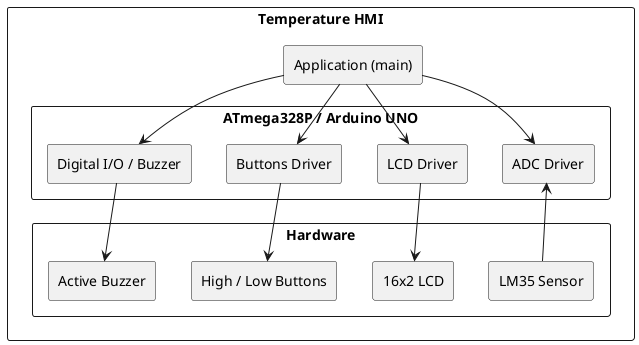
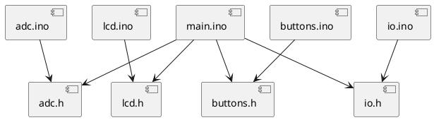

# Detailed Design Document — Temperature Monitoring HMI

| **Author** | Ali Mosallam - Mohamed Ayman - Yahia Rady |
|:--|:--|
| **Status** | Approved |
| **Version** | 1.0 |
| **Date** | 18/11/2026 |

## 1. Introduction

This document describes the design of a temperature-monitoring Human Machine Interface (HMI). An LM35 analogue temperature sensor is used by the system to measure the temperature. displays the readings from the sensor and user-configurable limitations is then displayed on a 16×2 LCD, and activates a buzzer when the measured temperature is outside the permitted range.

### 1.1 Purpose

The goal is to give a simple embedded interface the ability to monitor temperature and set higher and lower limits. The buzzer sounds a warning if the temperature isnt within the limit, which is then all displayed on the LCD.

### 1.2 Scope

The design includes:
- The ATmega328p is used to read analogue temperatures which is then coverted to digital through ADC.
- Teperature conversion from ADC counts to degrees Celcius.
- LCD then outputs in 4-bit parallel mode.
- Two push buttons allow the user to adjust the upper and lower limits.
- Buzzer provides an alert when the temperature is outside the selected range.
- The software is divided into separete modules and uses AVR registers to control the hardware.

However, the current design is limited to temperatue monitoring and does not include humidity or light measuremnts, wireless communication, data logging or automatuc calibartion.

## 2. Architectural Overview

The system is divided into an application layer and seperate hardware modules. The main program collects temperature readings, checks them against the set limits, displays the results on the LCD, and activates the buzzer when necessary.

### 2.1 Hardware connections

| Component | Connection |
|---|---|
| LM35 output | A0 / ADC0 / PC0 |
| LCD RS | D2 / PD2 |
| LCD Enable | D3 / PD3 |
| LCD D4, D5, D6, D7 | D4, D5, D6, D7 / PD4–PD7 |
| LCD RW | GND |
| LCD VSS / VDD | GND / +5 V |
| High-limit button | D8 / PB0 to GND |
| Low-limit button | D9 / PB1 to GND |
| Active buzzer control | D10 / PB2 |

### 2.2 Assumptions and constraints

- The system uses an ATmega328P microcontroller running at 16 MHz.
- The ADC uses is AVCC as its reference voltage, assumed to be 5V.
- The LM35 temperature sensor is assumed to produce an output of be 10 mV per 1°C increase.
- The ADC is configured for a prescaler of 128.
- The LCD is a standard 16×2 display in 4-bit mode.
- The two push-buttons are active-low and use the microcontrollers internal pull-up resistors.
- An active buzzer is used to provide alerts. If a passive buzzer is used it would require a generated tone rather than a constant logic level.
- The code's default temperature limits are 20°C and 38°C.
- The direct buzzer connection is suitable only if its input current is within the microcontroller pins safe operating limits. Otherwise a transistor driver should be used.
- Factors such as sensor accuracy, ADC reference voltage, and electrical noise can affect the displayed temperature.

## 3. Functional Description

The system continuously measures the surrounding temperature using an LM35 sensor connected to the ATmega328P. The measured values are converted into degrees Celcsius and displayed on the LCD. Two push buttons allow the user to adjust the upper and lower temperature limits. If the temperature goes outside the selected range, the buzzer is activated.

### 3.1 Startup

The firmware initializes digital I/O, LCD, ADC and push-button modules. It the briefly displays "Temperature HMI" and "System Ready" on the LCD before moving into the main loop.

### 3.2 Temperature acquisition

The ADC reads the analogue signal from the LM35 connected to channel 0 and converts it into a 10-bit digital value ranging fro 0 to 1023. With a 5V reference:

`Voltage = ADC_value × 5.0 / 1024`

Since the LM35 outputs approximately 10 mV per °C:

`Temperature (°C) = ADC_value × 500 / 1024`

The program uses integer calculations, meaning any decimal part is discarded and the temperature is displayed as a whole number.

### 3.3 Limit adjustment

The high-limit button increases the macimum temperature setting by 1°C per press, up to a maximum value of 99°C. The low-limit button similarly increases the lower limit by 1°C, as long as it stayes below the upper limit. The firmware uses a short delay to reduce button debouncing and waits for the button to be released before registering another press.

### 3.4 Alarm behaviour

The system checks whether the measured temperature falls within the range when:

`low_limit <= temperature <= high_limit`

The buzzer is switched on when the temperature is below the lower limit or above the upper limit. The LCD displays `OK` when the temperature is within the acceptable range and `NOK` when it goes outside the set limits.

### 3.5 Display

The LCD's top row displays the measured temperature and status. The second row displays the lower and upper limits.

## 4. Implementation of the Module

The software is divided into modules to make the program easier to understand, test, and maintain. Each module is responsible for a specific task:

- **main:** Handles the system startup, reads the buttons and temperature, checks limits, and updates the LCD and buzzer.
- **ADC:** configures the ADC and reads analogue values from the selected input channel.
- **LCD:** Initializes the display and provides functions to clearing the screen, moving the cursor, and displaying text.
- **Buttons:** configures the two push buttons using internal pull-up resistors and detects button presses while reducing unwanted bouncing.
- **I/O:** configures the buzzer output and switches it on or off.

The program accesses AVR registers directly, including `ADMUX`, `ADCSRA`, `DDRB`, `PORTB`, `PINB`, and `DDRD`/`PORTD`. Instead of relying on Arduino functions such as `analogRead()` or `digitalWrite()`.

## 5. Integration and Configuration 

The integration process involves connecting all hardware components to the ATmega328P and configuring the required pins and settings. The ADC, LCD, push bittons and butter are initialized through seperate software modules to ensure they work together correctly. Once everything is configured, he system is ready to monitor the temperature and respond to chnages.

### 5.1 Static files

| File | Responsibility |
|---|---|
| `main.ino` | Main application and control logic |
| `adc.h` | ADC function declarations |
| `adc.ino` | ADC initialization and conversion |
| `lcd.h` | LCD function declarations |
| `lcd.ino` | LCD low-level 4-bit driver |
| `buttons.h` | Button function declarations |
| `buttons.ino` | Button initialization and debouncing |
| `io.h` | Digital I/O function declarations |
| `io.ino` | Buzzer initialization and control |

### 5.2 Include structure

### 5.3 Configuration

| Name | Current value | Description |
|---|---:|---|
| `F_CPU` | 16,000,000 Hz | MCU clock frequency |
| ADC reference | AVCC (nominal 5 V) | ADC voltage reference |
| ADC prescaler | 128 | ADC clock divider |
| LM35 channel | ADC0 | Sensor input channel |
| Initial lower limit | 20°C | Default lower threshold |
| Initial upper limit | 38°C | Default upper threshold |
| High limit maximum | 99°C | Upper-limit software bound |
| LCD mode | 4-bit | Uses LCD data pins D4–D7 |
| Button inputs | PB0, PB1 | Active-low with pull-ups |
| Buzzer output | PB2 | Active-high control |

## 6. Verification and Test Strategy

The test procedures are located in `../test/assignment_test_cases.robot` and are designed to check the systems mmain functions. They include startup, temperature display on LCD, limit adjustment, buzzer activation below and above the allowed range, and prevention of the lower limit reaching or exceeding the upper limit.

The provided Robot Framework tests require the operatorto interacy with the physical system and manually enter the test results after observing its behaviour. They do not directly access the ADC readings or control the push buttons unless a separate hardware testing interface is added.

## 7. Limitations and Future Improvements

- Improve temperature measurment accuracy by using a calibrated ADC reference or measuring the actual AVCC voltage.
- Add a hardware testing interface foto allow automatic sensor and button testing.
- Ensure the LCD displays are properly aligned by filling each line exactly 16 characters.
- Add buttons for decreasing the temperature limits or introduce a menu if more controls are needed.
- Store configured limits in EEPROM to save selected temperature limits even after system is turned off.
- Add a transistor driver to control the buzzer if it requires more current than the microcontrollers GPIO pin can supply.
